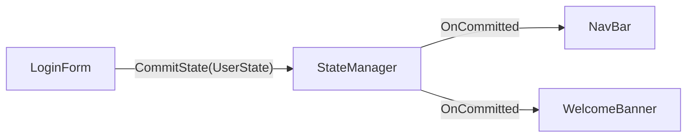
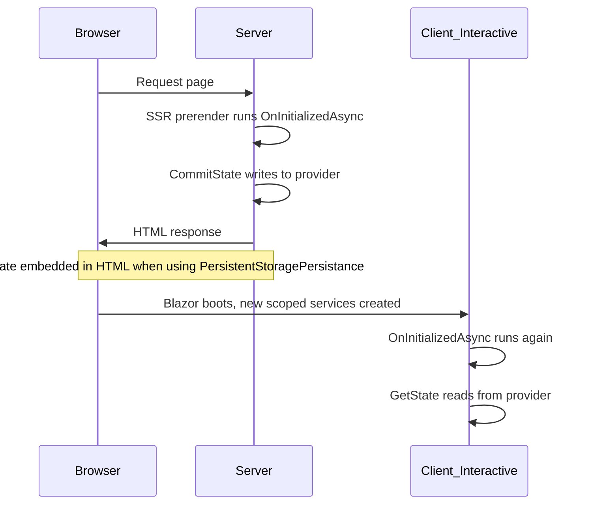
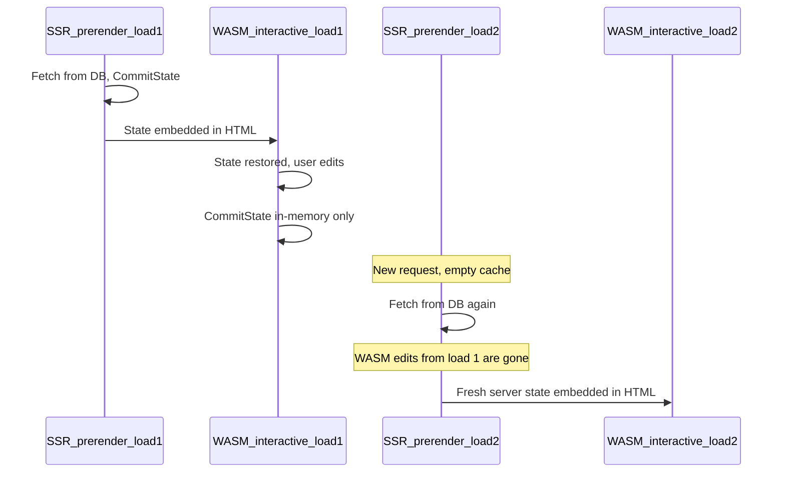

# BlazorStateManager

BlazorStateManager helps Blazor apps share data and events between components without tight coupling. Components that need the same information no longer have to reference each other — they subscribe to shared state instead.

It also addresses a common Blazor pain point: state loaded during SSR prerender silently disappears when the page becomes interactive. Choose a storage provider that matches your render mode and persistence needs, and `IStateManager` handles the rest.

## Decoupled components example

Three components share login state. None of them reference each other.

```csharp
public record UserState(string UserName, bool IsLoggedIn);
```

**LoginForm.razor** — commits state; does not know who is listening:

```razor
@inject IStateManager StateManager

<button @onclick="Login">Log in</button>
<button @onclick="Logout">Log out</button>

@code {
	private async Task Login()
	{
		await StateManager.CommitState(new UserState("Alice", true));
	}

	private async Task Logout()
	{
		await StateManager.CommitState(new UserState(string.Empty, false));
	}
}
```

**NavBar.razor** — subscribes; does not know about `LoginForm` or `WelcomeBanner`:

```razor
@inject IStateManager StateManager
@inject IMediator Mediator
@implements IDisposable

<nav>
	@if (user.IsLoggedIn)
	{
		<span>Hello, @user.UserName</span>
	}
	else
	{
		<span>Sign in</span>
	}
</nav>

@code {
	private UserState user = new(string.Empty, false);

	protected override Task OnInitializedAsync()
	{
		StateManager.OnCommitted<UserState>(this, async (_, updated) =>
		{
			user = updated ?? new(string.Empty, false);
			await InvokeAsync(StateHasChanged);
		});

		return Task.CompletedTask;
	}

	public void Dispose()
	{
		Mediator.UnSubscribe<UserState>(this);
	}
}
```

**WelcomeBanner.razor** — same pattern, completely isolated from the other two:

```razor
@inject IStateManager StateManager
@inject IMediator Mediator
@implements IDisposable

@if (user.IsLoggedIn)
{
	<h2>Welcome back, @user.UserName!</h2>
}

@code {
	private UserState user = new(string.Empty, false);

	protected override Task OnInitializedAsync()
	{
		StateManager.OnCommitted<UserState>(this, async (_, updated) =>
		{
			user = updated ?? new(string.Empty, false);
			await InvokeAsync(StateHasChanged);
		});

		return Task.CompletedTask;
	}

	public void Dispose()
	{
		Mediator.UnSubscribe<UserState>(this);
	}
}
```

When the user clicks **Log in**, `LoginForm` commits `UserState`. `NavBar` and `WelcomeBanner` both update — without any direct references between them.



## Installation

```bash
dotnet add package BlazorStateManager
```

Register in `Program.cs`:

```csharp
using BlazorStateManager.StoragePersistance;

builder.Services.AddBlazorStateManagerServices<LocalStoragePersistance>();
```

Add to `_Imports.razor` (or individual components):

```csharp
@using BlazorStateManager.Mediator
@using BlazorStateManager.State
@using BlazorStateManager.StoragePersistance
```

This registers:

- `IMediator` as a **singleton** (`BlazorMediator`)
- `IStateManager` as **scoped** (`StateManager`)
- `IStoragePersistance` as **scoped** (your chosen implementation)

## The three services

| Service | Purpose |
|---|---|
| [`IMediator`](#imediator) | Pub/sub event bus between components |
| [`IStateManager`](#istatemanager) | Typed state with persistence and change notifications |
| [`IStoragePersistance`](#istoragepersistance) | Low-level storage without change notifications |

Prefer `IStateManager` in most components. Use `IMediator` directly when you need events without persistence. Use `IStoragePersistance` only when you need storage without notifications.

## Rendering modes and storage providers

Blazor apps commonly prerender on the server, then hydrate to an interactive render mode (Server or WebAssembly). Storage behavior depends on which provider you choose and which phase of the page lifecycle is running.

`IMediator` is pure in-memory C# and works in every render mode.

### Provider comparison

| Provider | Persists to | JS required | SSR prerender | Interactive |
|---|---|---|---|---|
| `LocalStoragePersistance` | Browser `localStorage` | Yes | In-memory fallback | Browser storage |
| `SessionStoragePersistance` | Browser `sessionStorage` | Yes | In-memory fallback | Browser storage |
| `CookieStoragePersistance` | Browser cookies | Yes | In-memory fallback | Browser cookies |
| `MemoryStoragePersistance` | In-memory only | No | Works | Works (circuit/request scope) |
| `PersistentStoragePersistance` | HTML response payload | No | Writes to cache + HTML | Restored from HTML, then in-memory |

```csharp
builder.Services.AddBlazorStateManagerServices<LocalStoragePersistance>();
// OR SessionStoragePersistance, CookieStoragePersistance,
// MemoryStoragePersistance, PersistentStoragePersistance
```

JS-backed providers extend `JsInteropStoragePersistance`, which mirrors data in an in-memory cache and silently skips browser writes when JS interop is unavailable during SSR prerender.

### Page lifecycle

Every prerendered interactive page goes through this sequence:



### PersistentStoragePersistance

`PersistentStoragePersistance` uses Blazor's `PersistentComponentState` API (available since .NET 6) to serialize state during SSR prerender and restore it when the page becomes interactive. This avoids the double-fetch problem where `OnInitializedAsync` runs on the server, then again on the client with empty state.

```csharp
builder.Services.AddBlazorStateManagerServices<PersistentStoragePersistance>();
```

No extra registration is required — `PersistentComponentState` is registered automatically by the Blazor framework.

**Dashboard example** — fetch once on the server, restore on the client:

```csharp
public class DashboardMetrics
{
	public bool IsLoaded { get; set; }
	public decimal Revenue { get; set; }
}
```

```razor
@page "/dashboard"
@rendermode InteractiveWebAssembly
@inject IStateManager StateManager
@inject IDashboardService DashboardService

@if (!metrics.IsLoaded)
{
	<p>Loading...</p>
}
else
{
	<p>Revenue: @metrics.Revenue</p>
}

@code {
	private DashboardMetrics metrics = new();

	protected override async Task OnInitializedAsync()
	{
		metrics = await StateManager.GetState<DashboardMetrics>();

		if (!metrics.IsLoaded)
		{
			metrics = await DashboardService.GetMetricsAsync();
			metrics.IsLoaded = true;
			await StateManager.CommitState(metrics);
		}
	}
}
```

1. **SSR prerender** — `CommitState` writes to the in-memory cache. When rendering completes, the cache is serialized into the HTML response.
2. **Interactive render** — A new scoped instance restores the cache from the HTML payload. `GetState<T>()` returns the server-fetched data without calling the API again.

**Security note:** Persisted state is embedded in the HTML response. In `InteractiveWebAssembly` and `InteractiveAuto` render modes, this payload is visible in the browser. Do not store sensitive data (tokens, PII) with this provider.

### The stale-state problem

`PersistentStoragePersistance` bridges **one** SSR-to-interactive handoff per page load. It does not persist client-side edits across navigations.



**What this means:**

- User edits made in WebAssembly are stored in the scoped in-memory cache only.
- When the user navigates away and returns, a new SSR prerender runs with an empty cache.
- The server fetches fresh data; client edits from the previous visit are lost before the interactive render even starts.

**When WASM edits must survive navigation**, use `LocalStoragePersistance` or `SessionStoragePersistance` as your primary provider. On the first interactive render, prefer browser storage over any prerender snapshot:

```razor
protected override async Task OnAfterRenderAsync(bool firstRender)
{
	if (!firstRender)
	{
		return;
	}

	var stored = await StateManager.GetState<ShoppingCart>();
	if (stored.Items.Count != cart.Items.Count)
	{
		cart = stored;
		StateHasChanged();
	}
}
```

Use `PersistentStoragePersistance` when server-sourced read-only reference data (catalog, config, profile) should not be re-fetched on every interactive render — not when users edit that data in the browser.

### [PersistentState] on services (.NET 10)

In .NET 10, the `[PersistentState]` attribute provides a declarative alternative to the imperative `PersistentComponentState` API that `PersistentStoragePersistance` uses internally. Use it when a scoped service owns the data and multiple components need to react to changes through `IStateManager`.

This pattern is **additive** — persist on the service property, then commit through `IStateManager` so other components receive notifications.

```csharp
public class ProductService
{
	[PersistentState]
	public ProductCatalog? Catalog { get; set; }

	public async Task InitializeAsync(IProductApi api, IStateManager state)
	{
		Catalog ??= await api.GetCatalogAsync();
		await state.CommitState(Catalog);
	}
}
```

Register the service for persistence:

```csharp
builder.Services.AddScoped<ProductService>();

builder.Services.AddRazorComponents()
	.AddInteractiveServerComponents()
	.AddInteractiveWebAssemblyComponents()
	.RegisterPersistentService<ProductService>(RenderMode.InteractiveAuto);

builder.Services.AddBlazorStateManagerServices<LocalStoragePersistance>();
```

`RegisterPersistentService` tells Blazor to persist `[PersistentState]` properties across prerendering for the specified render modes. Only **scoped** services are supported.

Use `??=` in initialization so data is fetched only when prerender state was not restored:

```csharp
Catalog ??= await api.GetCatalogAsync();
```

### Choosing the right provider

| Scenario | Recommended provider |
|---|---|
| Server-fetched data should be available immediately in interactive render; user edits do not need to survive reload | `PersistentStoragePersistance` |
| User edits must survive page reloads and navigation | `LocalStoragePersistance` or `SessionStoragePersistance` |
| Pure SSR with no interactivity, or unit testing | `MemoryStoragePersistance` |
| Server-fetched read-only data plus user edits that must both survive | `LocalStoragePersistance` for user edits; fetch server data once and cache in browser storage, or use `PersistentStoragePersistance` only for read-only reference data |

| Approach | Best for |
|---|---|
| `PersistentStoragePersistance` | Any state committed through `IStateManager` should survive prerender without component changes |
| `[PersistentState]` on a service | A scoped service owns the data; declarative persistence plus `IStateManager` for notifications |
| `LocalStoragePersistance` | State must survive full page reloads in the browser |
| `MemoryStoragePersistance` | Request/circuit-scoped state with no prerender bridge or browser persistence |

## IMediator

The mediator lets components publish and subscribe to typed events with optional named topics. Subscribers are held via weak references and should unsubscribe when disposed.

Segregate **notification** topics (for example, "cart changed") from **command** messages (for example, "add this item to cart"). Keeping the two kinds of messages distinct avoids subtle bugs.

```razor
@inject IMediator Events
@implements IDisposable

<p>Checkout count: @count</p>

@code {
	private int count;

	protected override Task OnInitializedAsync()
	{
		Events.Subscribe<string>(this, "CheckoutFinished", async (_, _) =>
		{
			count = 0;
			await InvokeAsync(StateHasChanged);
		});

		return Task.CompletedTask;
	}

	private async Task UpdateCart(string item)
	{
		await Events.Publish(this, "CartUpdated", item);
	}

	public void Dispose()
	{
		Events.UnSubscribe<string>(this, "CheckoutFinished");
	}
}
```

### API

```csharp
public delegate Task AsyncHandler<T>(object sender, T? value);

public interface IMediator
{
	void Subscribe<T>(object subscriber, AsyncHandler<T> handler);
	void Subscribe<T>(object subscriber, string topic, AsyncHandler<T> handler);
	Task Publish<T>(object sender, T? value);
	Task Publish<T>(object sender, string topic, T? value);
	void UnSubscribe<T>(object subscriber);
	void UnSubscribe<T>(object subscriber, string topic);
	void UnSubscribeAll(object subscriber);
}
```

## IStateManager

`IStateManager` is the recommended way to read and write shared state. It persists through the configured storage provider and publishes change notifications through `IMediator`.

- `CommitState<T>(T? value)` stores using the type's full name as the key.
- `CommitState<T>(string key, T? value)` stores under an explicit key and publishes to a named topic.
- `GetState<T>()` returns a new empty instance when nothing is stored.

```razor
@inject IStateManager StateManager
@inject IMediator Mediator
@implements IDisposable

@code {
	private ShoppingCart cart = new();

	protected override async Task OnInitializedAsync()
	{
		cart = await StateManager.GetState<ShoppingCart>();

		StateManager.OnCommitted<ShoppingCart>(this, async (_, updated) =>
		{
			cart = updated ?? new ShoppingCart();
			await InvokeAsync(StateHasChanged);
		});
	}

	private async Task SaveCart()
	{
		await StateManager.CommitState(cart);
	}

	public void Dispose()
	{
		Mediator.UnSubscribe<ShoppingCart>(this);
	}
}
```

### API

```csharp
public interface IStateManager
{
	Task CommitState<T>(string key, T? value);
	Task CommitState<T>(T? value);
	ValueTask<T?> GetState<T>() where T : class, new();
	ValueTask<T?> GetState<T>(string key) where T : class, new();
	void OnCommitted<T>(object subscriber, AsyncHandler<T> handler);
	void OnCommitted<T>(object subscriber, string key, AsyncHandler<T> handler);
}
```

## IStoragePersistance

Use this interface directly only when you need storage without change notifications. In most apps, prefer `IStateManager`.

```csharp
public interface IStoragePersistance
{
	ValueTask<T?> Retreive<T>(string name) where T : class, new();
	ValueTask Store<T>(string name, T? data);
}
```

Direct usage:

```razor
@inject IStoragePersistance Storage

@code {
	private ShoppingCart cart = new();

	protected override async Task OnInitializedAsync()
	{
		cart = await Storage.Retreive<ShoppingCart>("ShoppingCart") ?? new ShoppingCart();
	}

	private async Task Save()
	{
		await Storage.Store("ShoppingCart", cart);
	}
}
```

Store keys as named constants rather than inline strings:

```csharp
public static class StorageKeys
{
	public const string ShoppingCart = "ShoppingCart";
}
```
